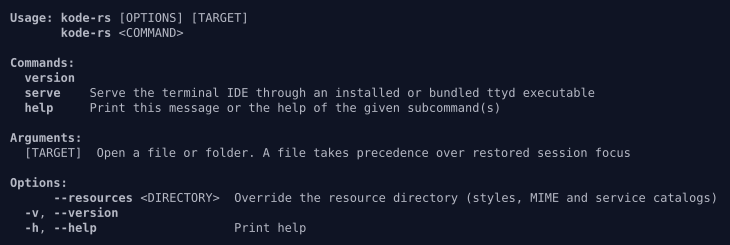
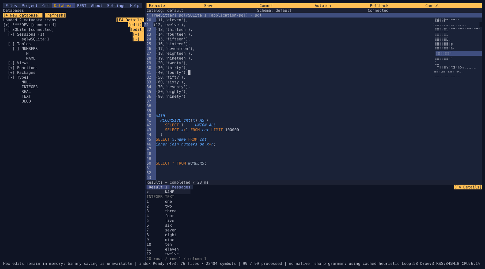
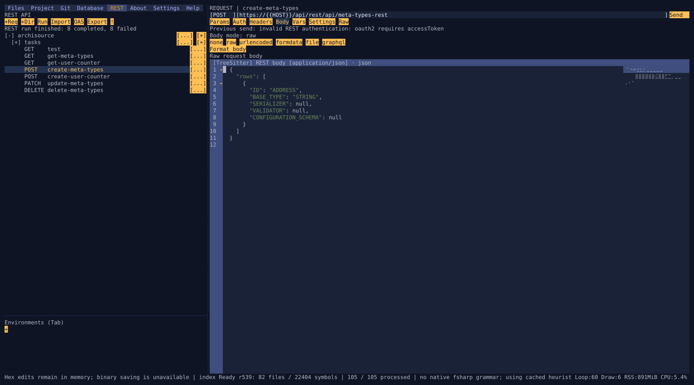
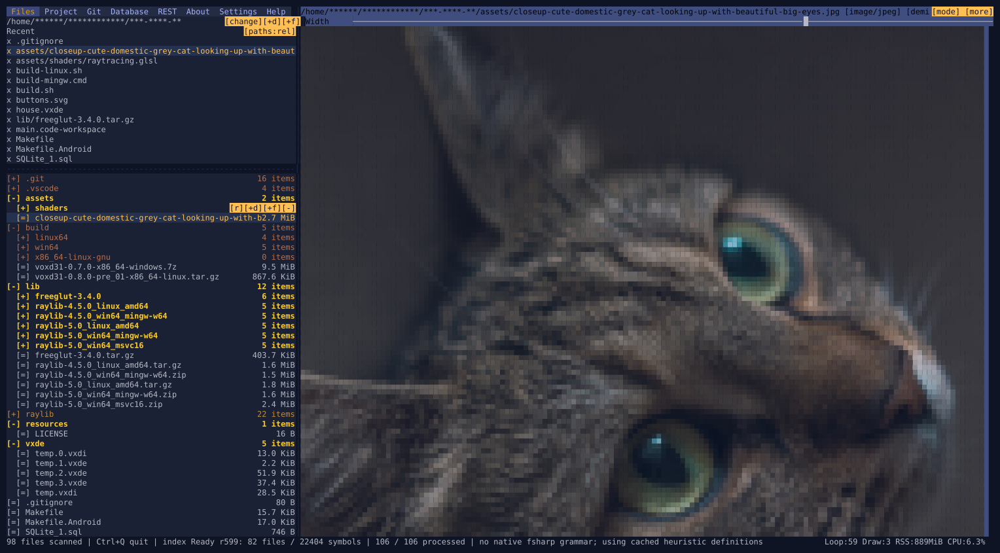
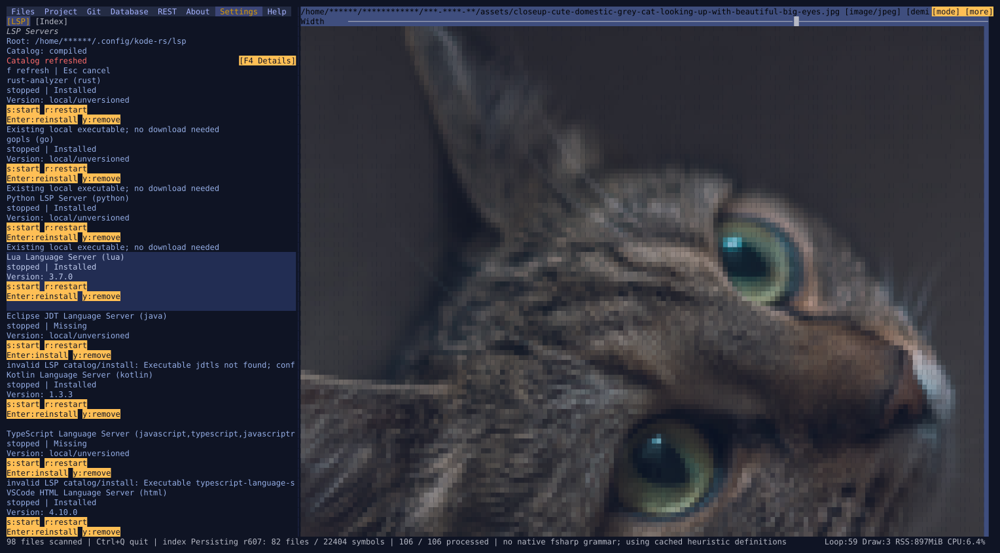
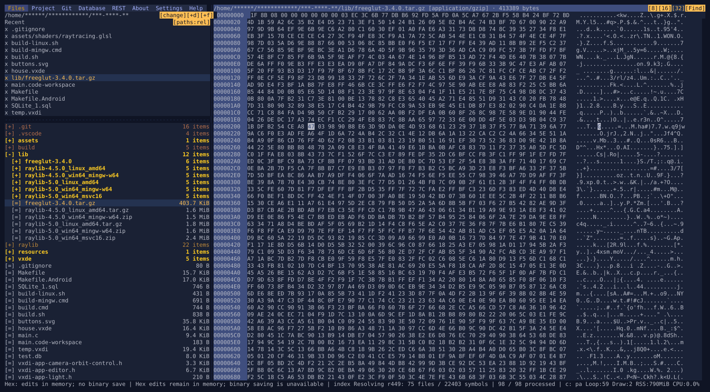

# kode-rs

LSP Install fixture / request 35

Planned Rust migration of the Kode terminal IDE. The implementation reference is
`../kode`, commit `7d3e5953ec2de75f2b5e9c44fb3e65549d39ec68` (audited 2026-10-14).

Implementation is underway. [DASHBOARD.md](DASHBOARD.md) records all 79 task statuses,
ongoing work and links to acceptance evidence. Open a file or folder with
`cargo run -p kode -- /path/to/project`; Ctrl+S saves and Ctrl+Q saves workspace
state and quits. The shell includes file/project panels, search, text editing,
hex inspection, portable image viewing, syntax/semantic highlighting and native
completion/navigation, local Git operations and diff views, SQL/JDBC and REST.
The remaining [finalized UAT requests](docs/migration/UAT.md), final editor
qualification and release work continue in dependency order.
`cargo check --workspace`, `--help` and `--version` work on stable Rust.
The Rust application is a TUI. JDBC runs in an **external JVM**;
the Rust process does not embed a JVM.

Ctrl+T opens your shell in the workspace directory. Type `exit` to return to the
editor; terminal modes, caret and unsaved buffers are retained. Browser terminal
mode is `kode serve [--port 11045] [folder] [-- <ttyd arguments>]`. It binds
`127.0.0.1` by default; use `--public` or `--host` for another bind address and
`--credential user:password` for Basic authentication. Install `ttyd` on PATH,
place its executable beside `kode`, or set `KODE_TTYD` to its executable path.
`python3 scripts/build-ttyd.py` builds a pinned standalone ttyd executable and
records provenance; native development libraries listed by its `--help` are
required. Linux x86_64 GNU archive builds now include the standalone ttyd, its
relative native library closure, and full dependency notices. Build and acceptance
commands are in [the distribution guide](packaging/README.md). The manual
[release workflow](.github/workflows/distribution.yaml) builds portable Linux,
Windows and macOS archives on x86_64 and arm64, architecture-specific Linux
AppImages and Snaps, Windows MSI/MSIX, macOS DMGs, the standalone JDBC adapter
JAR, and optional Java runtimes. A release is published only after the complete
matrix succeeds. [Z03 tracks qualification](docs/migration/Z03-ARTIFACT-MATRIX.md).
`--resources DIRECTORY` within `serve` selects the child IDE's resource override.
Remaining arguments after `--` pass literally to ttyd; an unknown option also
starts forwarding, matching the original CLI.

For remote access, keep the loopback bind and use
`ssh -L 11045:127.0.0.1:11045 remote-host`, then open
`http://127.0.0.1:11045`. Browser tabs reserve shortcuts such as Ctrl+T/Ctrl+W;
`google-chrome --app=http://127.0.0.1:11045` is the existing app-window workaround.
Classic terminal keyboard encodings can also merge Ctrl+Enter with Enter; use
the SQL Execute and REST Send buttons in those terminals. Browser clipboard
paste and xterm selection copy remain available. ttyd notice logs are suppressed
when credentials are supplied because its notices include a reversible Basic
auth token; explicitly forwarding a higher ttyd `--debug` level enables those logs.

REST OAuth acquisition is available in each request's Auth tab. Choose OAuth 1.0
or OAuth 2.0, fill the OAuth settings and use Acquire token. Copy the displayed
login URL into a GUI browser. Kode receives the callback at
`https://localhost:<free-port>/callback`; the temporary self-signed certificate
may require browser acceptance, and the provider must allow that redirect URI.
Remote sessions can paste the complete redirect URL instead. Refresh and Clear
are explicit actions; acquired tokens are kept only for the current workspace
session and are omitted from saved collections and exports.

Files → Recent shows project-relative paths by default, including directories
that distinguish equal filenames. Outside-project files stay absolute. Click
`[paths:rel]` / `[paths:full]`, or press **P** while Files is focused, to toggle
full paths. Each project remembers this display preference; file identity and
save targets stay the same.

Shared text editors support multiple cursors: **Alt+left-click** adds a cursor
or removes one already there, **Alt+drag** adds a selection, and
**Ctrl+Shift+Up/Down** adds a cursor on the previous/next visual row. **Alt+Enter**
in file find selects every occurrence and returns to editing. Typing, deletion,
paste and undo/redo operate on the whole selection set. Copy/cut joins selected
text in source order with newlines; paste repeats the full clipboard at each
selection. **Escape** keeps the primary cursor; a plain click starts one cursor.
File, SQL, REST and environment editors share these controls. Read-only previews
allow selection and copying while preserving their mutation guard.

**Double-click** selects a Unicode word; **Alt+double-click** adds that word to
the existing selections, with its cursor at the end. Clicks pair within 350 ms;
a third click starts a new pair. Whitespace and punctuation follow Unicode word
segments, and blank space beyond a line keeps a caret. Tabs and escaped Unicode
glyphs select the source under the pointer. Word analysis runs on a worker;
navigation, typing or resizing cancels an unfinished selection.

Path fields offer **Browse** (a compact **[...]** button in narrow views) and
**Alt+P**: REST Postman/OpenAPI import, Postman export, SQL Save, Local JAR(s),
binary request bodies and multipart file rows. The chooser supports a typed path,
parent navigation with **F4**, a file tree, and new save filenames. **Tab** cycles
its controls; **Enter** activates the focused control, and **Escape** cancels.
Selecting changes the field; submit the owning dialog to import, export or save.
For Local JAR(s), Browse replaces the entry at the caret and preserves the rest
of the native classpath. In a multipart file row it replaces a single source or
adds to an existing JSON source array. Workspace, source-root and exclusion
selectors use the same chooser and retain their project configuration rules.

The hex viewer offers **8 / 16 / 32** bytes per row in its header; **F8** cycles
layouts while retaining the byte selection and scroll anchor. **Ctrl+F** opens
find. **Tab** switches literal UTF-8 text and hex bytes (`00 FF 41` or `00FF41`);
Enter / Shift+Enter finds the next / previous match and wraps at the ends.
F3 / Shift+F3 repeats from the byte view. Escape closes find and cancels its
worker; Stop cancels while keeping the field open. Large searches run off the
UI thread. Alt+C/X/V retains the private raw-byte clipboard; the find field uses
the text clipboard. Byte edits remain temporary and cannot be saved to disk.

The external JDBC protocol/bootstrap/supervisor is available as a backend. Build
and test it with `bash scripts/test-jdbc-bridge.sh` using Java 21 and Maven; the
packaged helper needs only Java at runtime. `KODE_JAVA` selects Java and
`KODE_JDBC_HELPER` selects the helper JAR. Ordinary editor startup requires neither.
If Java is missing or too old, **F5 Get Java** in Databases or the connection
form offers a separate optional runtime download. Download, Cancel, Retry and
Hide keep the operation explicit; a hidden download continues while you edit.
After installation, retry Test or Connect explicitly. Configured/local Java takes
precedence, and startup never fetches runtime metadata. The Linux x86_64 GNU
runtime is qualified; other platform assets remain unavailable until qualified.
`KODE_RUNTIME_RELEASE_URL` selects an alternative latest-release metadata endpoint
for a mirror or local fixture. Downloads verify archive and file checksums before
atomic installation under the database home's `java-runtime` directory.
Driver resolution/loading now supports Maven, local multi-JAR and manual vendor
sources, versioned install manifests and isolated loaders. The backend supports
temporary connection tests, shared datasource connections, context changes and
commit/rollback through serialized JDBC owners. SQL execution streams typed,
bounded previews and supports independent cancellation; helper failure retains
received rows and never replays SQL. Open **Databases** with Alt+4: `n` creates a
datasource, F2 edits, `c` connects/disconnects, `r` refreshes metadata, `R` explicitly
restarts the database service and `s` opens a SQL editor. The connection dialog
uses Alt+T to test, Alt+D to install a driver and Ctrl+S to save. Click Templates
beside JDBC URL, or press Down in that field, for the current type's recent URLs
and standard templates. Changing type preserves a typed URL; Escape cancels
the menu. Passwords are masked and stored separately from
public definitions. SQL consoles share the editor: Ctrl+Enter executes the current
statement or selection, Ctrl+Shift+Enter executes the script, Escape requests
cancellation, and Ctrl+Alt+A/C/R changes shared autocommit/commit/rollback state.
Ctrl+S exports a guarded `.sql` file; unsaved console buffers and context bindings
also survive workspace restarts. Click Catalog/Schema to bind a console. Results
keep their own focus; Alt+Arrows/PageUp/PageDown scroll and Alt+Tab switches result
sets/messages while the editor stays focused. Hover Execute to preview its target.
Press F4 or click Details to read complete wrapped database/SQL diagnostics. Use
arrows, PageUp/PageDown, Home/End or the mouse wheel to scroll; Ctrl+C or Copy
copies the full redacted message, and Escape restores the previous view.
End-to-end JDBC qualification is recorded in [D09](docs/parity/D09.md).
After a helper crash, check the database outcome, then use Alt+4, `R` to restart
the service and `c` to reconnect. Previous SQL is retained and never replayed.

Open **REST** with Alt+5. `/` filters the collection; `n` adds a request, `f` a
folder, `m` opens actions, `i` imports Postman, `e` exports and `r` runs/stops the
selected request or folder. The actions menu also imports OpenAPI into a folder.
Tab selects environments: `n` creates, `c` copies, F2 renames and Space activates.
Environment values use the shared editor and survive restart, including comments
and unfinished lines. Drag the environment divider to resize it. Open a request
for method/URL controls and params/auth/headers/body/variables/settings/raw tabs.
Ctrl+Enter sends or stops; Ctrl+Tab switches request tabs from an editor. Header
names complete with Ctrl+Space. Request edits, comments and unfinished headers
survive restart. Responses have Body/Headers/Cookies/Raw/Transaction tabs, a
draggable divider and optional display formatting. Format body explicitly changes
the editable body and supports undo. Folder/collection runs show selectable
per-request progress and outcomes. F7 opens run history; click or Enter an outcome
to inspect it, and use Stop/Run again to control the selected run. Panel sizes and
Pretty preferences survive restart; runtime responses and cookies do not.
Postman scripts are preserved without execution. The Auth tab now offers No Auth,
API Key, Bearer, Basic, Digest, OAuth 1.0, OAuth 2.0, Hawk, AWS Signature, NTLM and
Akamai EdgeGrid. Click a credential row to edit it; Reveal secrets controls masking.
OAuth acquisition and browser callbacks are qualified in [R10](docs/parity/R10.md).
OAuth 1.0 uses HMAC-SHA1, AWS uses SigV4, Hawk supports SHA256/384/512,
and NTLM uses NTLMv2. Advanced-auth 3xx responses remain visible for explicit review;
credentials/signatures do not automatically follow redirects. Digest/NTLM work
with HTTP/SSE; their WebSocket upgrade negotiation has an explicit error. Protocol
qualification is recorded in [R09](docs/parity/R09.md).

Ctrl+Space requests completion and Ctrl-click follows definitions/usages.
The Project panel provides `r` rescan, `b` rebuild index and `c` clear index.
Indexing runs on bounded workers, uses unsaved buffers and persists its cache in
`.kode-rs/index.sqlite` without Java or language servers. `KODE_CODEINTEL_PATH`
can select a custom definitions catalog. Kotlin/C have specialized extraction;
other languages use conservative AST or explicit regex fallback capabilities.

Open **Settings** with Alt+7 for language-server discovery and installation.
Tab or the LSP/Index buttons switch between language servers and native cache
controls. In Index, `r` rescans, `b` rebuilds and `c` clears the rebuildable Rust
cache. The panel shows scan/extract/resolve/persist progress and scrolls with
Up/Down/Page/Home/End or the mouse wheel. These controls leave user JDBC databases
and dirty editor buffers intact.
Use `f` to refresh, Enter to install/update, `y` to remove, and Escape to cancel.
F4 Details opens the full operation error or selected server details. The dialog
wraps text, scrolls with arrows/Page/Home/End, and copies all text with Ctrl+C.
`KODE_LSP_CATALOG` selects a custom catalog and `KODE_LSP_HOME` selects the install
root. Existing local executables and manifest command arrays are supported.
The shipped TypeScript server needs Node.js 22.22.2 or newer; HTML, CSS and JSON
servers need Node.js 18 or newer. Their pinned packages install inside the selected
LSP root without global npm installs or package lifecycle scripts. The pinned
JDT LS milestone needs Java 25 or newer; select it with `JAVA_HOME` or PATH.
JDT configuration and data are kept separately for each project. These runtimes
remain optional: native editing and intelligence do not require Node or Java.
Use `s` to start/stop and `r` to restart a server. Running state follows the actual
initialized child; workspace changes and exit stop and reap owned servers.
Opening a file attempts to start its first matching local server in the background;
it never installs a package. Current non-empty LSP definitions, references and
completion take precedence; missing, crashed, empty or failing servers use native
intelligence. Highlighting and definition previews retain native styling.

Sidebar tabs run horizontally in source order: Files, Project, Git, Database,
REST, About, Settings, Help. Existing numbered shortcuts retain their actions:
Alt+1 Files, Alt+2 Project, Alt+3 Git, Alt+4 Database, Alt+5 REST, Alt+6 About,
Alt+7 Settings, Alt+8 Help. Ctrl+F opens file find/replace; Alt+F opens project search.
Ctrl+Alt+F and Ctrl+Shift+F remain project-search aliases when delivered by the
terminal host. Neither is required for project search.

Help scrolls and is generated from the same command catalog used by reducers.
About shows the version, MIT license, source links, dependency credits and loaded
languages; Tab switches between its independently scrollable lists. The wide
status line and native index settings show actual loop/draw FPS, process resident
memory and CPU normalized across available logical CPUs. Samples run in background
jobs without Java. Idle terminal fixtures measured two draws per second; input
and worker notifications trigger immediate redraws. See [Z02](docs/parity/Z02.md).
`python3 scripts/credits.py --check --offline` checks the checked-in dependency
credits against Cargo.lock; omit `--check` to regenerate after dependency changes.

Open **Git** with Alt+3. Space stages/unstages the selected status row; `a` stages
all rows and `A` unstages them. Tab enters the shared commit-message editor,
Ctrl+Enter commits, and Ctrl+Tab cycles sections. Outside that editor, `b` selects
a local branch, `t` creates a tag, and `T` explicitly creates or moves a tag on the
selected commit. Enter expands history; `m` copies its message into the draft.
Checkout preserves local changes and refuses dirty file or binary buffers.
Enter on a status row opens its diff in the main pane. `c` toggles context, `v`
switches side-by-side/unified presentation, and Enter/`r` or a center arrow restores
the selected unstaged text chunk. Previews support shared selection, copy and find;
staged/historical comparisons are read-only. Leaving Git restores the ordinary viewer.

Use the latest Rust **stable** toolchain (`rustup update stable`). This workspace
selects `stable` through `rust-toolchain.toml`, as requested. Dependency versions
are captured in `Cargo.lock`; validation reports record the exact compiler used.

## Start here

1. Read [scope and architecture](docs/migration/PLAN.md).
2. Read [shared contracts](docs/migration/CONTRACTS.md) before implementing a component.
3. Pick a ready task in the [task index](docs/migration/TASKS.md), then read its linked card.
4. For editor work, also read the [editor interaction contract](docs/migration/EDITOR-UX.md).
5. For database work, also read the [external JDBC protocol](docs/migration/JDBC.md).

Supporting documents:

- [Crate research and selection](docs/migration/CRATES.md)
- [Compatibility, fixtures, and release acceptance](docs/migration/COMPATIBILITY.md)
- [Complete Kotlin source allocation](docs/migration/SOURCE-MAP.tsv)
- [Agent handoff procedure](docs/migration/HANDOFF.md)

The task index is the execution ledger. No task is complete merely because a crate
was selected or a screen can render. Completion includes the behavior and UX
checks in its card and the relevant acceptance matrix.
