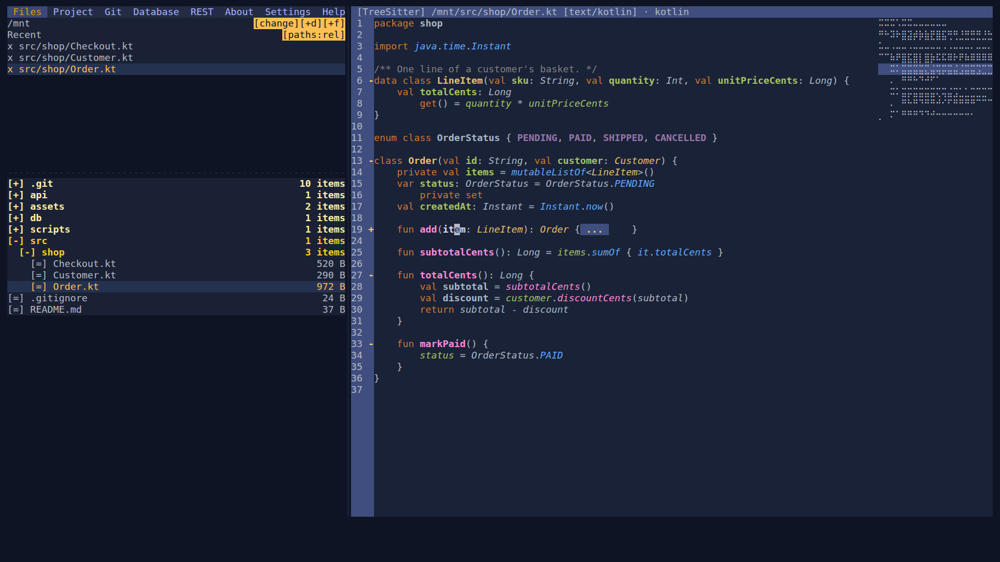
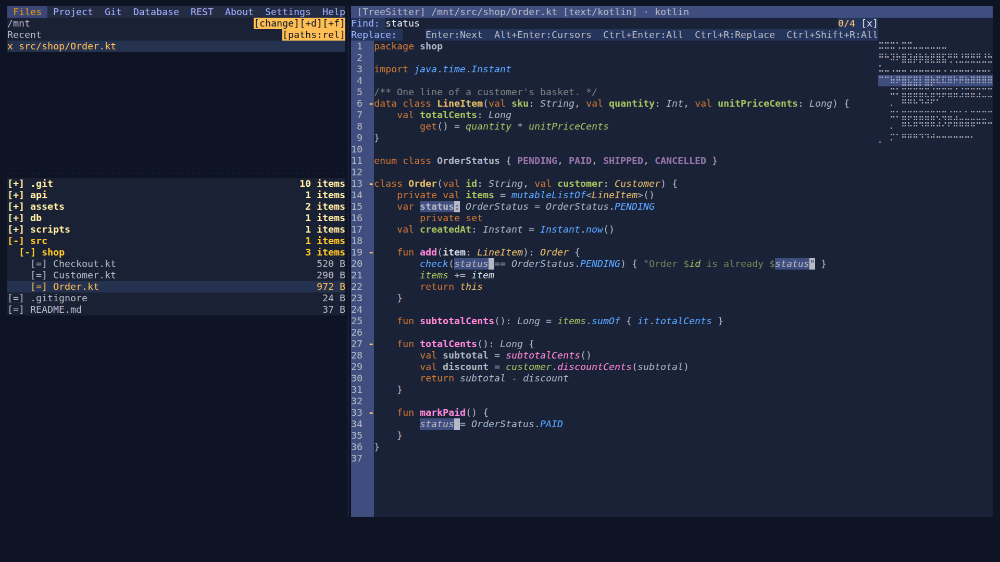
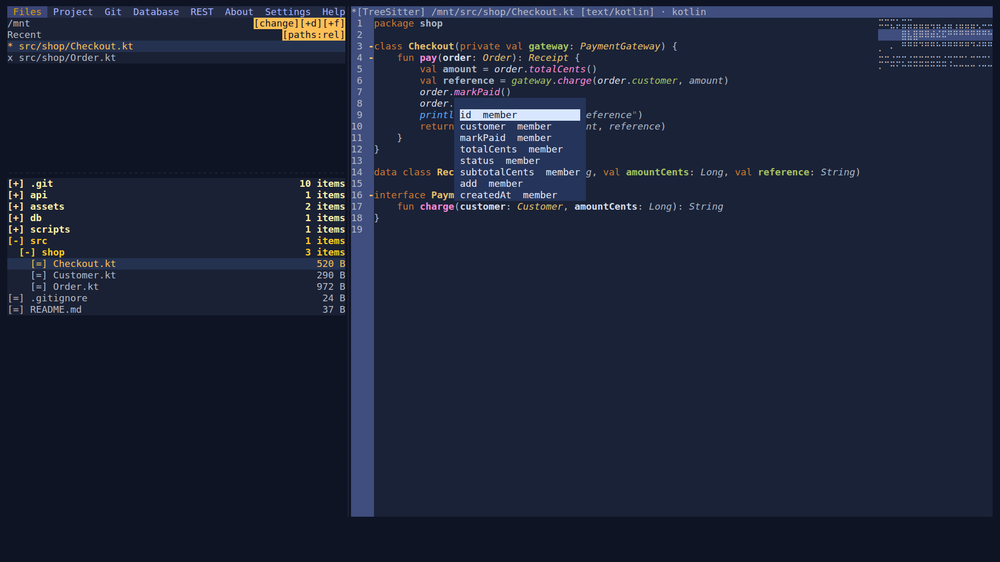
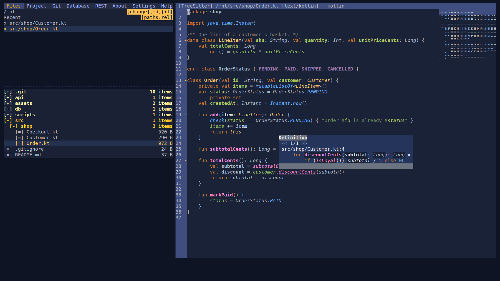
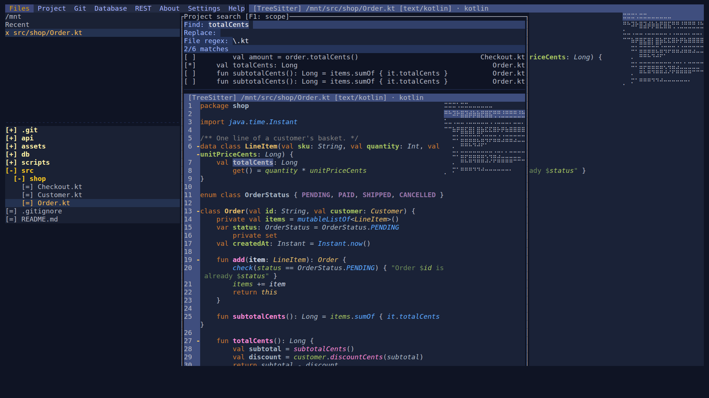
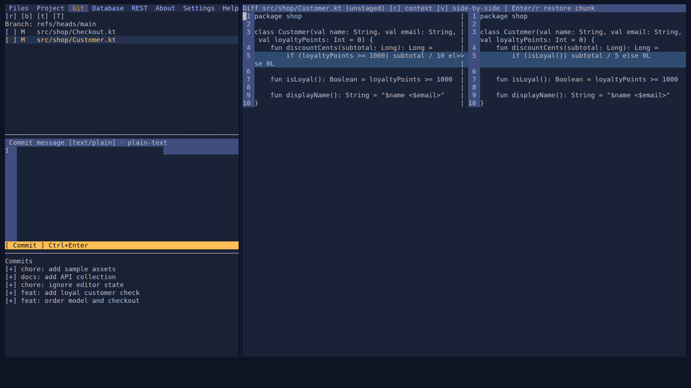
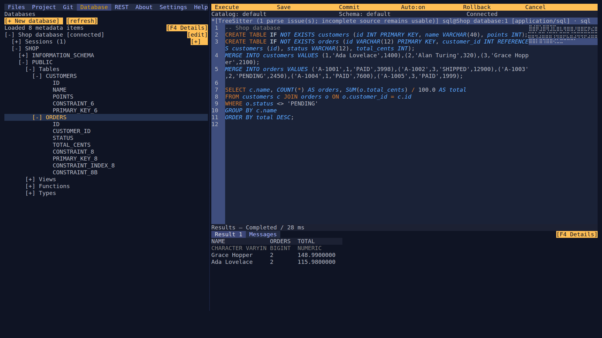
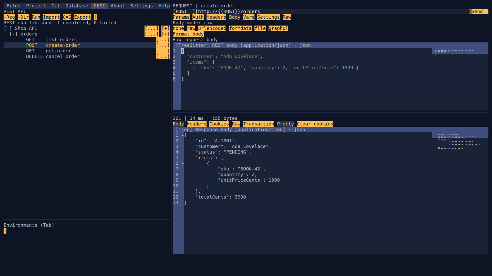
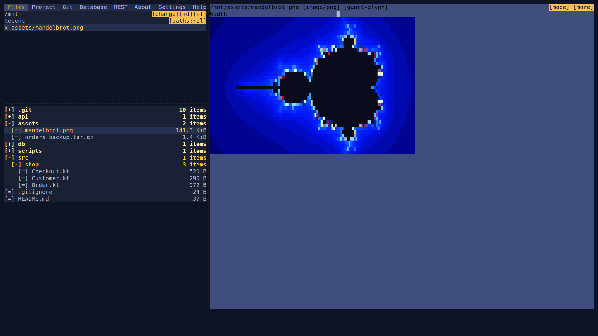
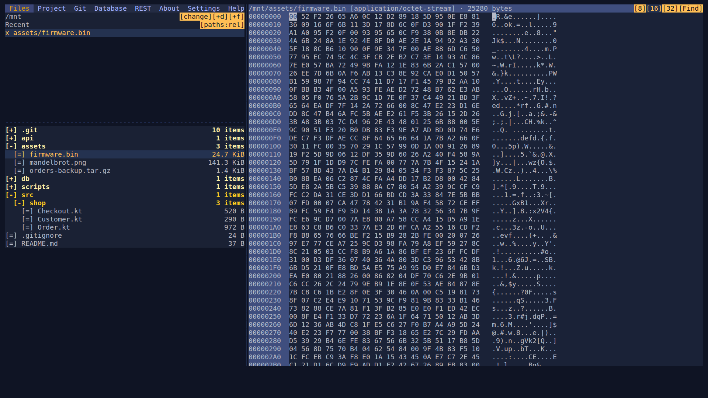

# Kode

**A full code editor and IDE that runs in your terminal.** Open a project over SSH or locally and get a mouse-aware editor with code intelligence, search, Git, database and REST clients, plus image and hex viewers, all without leaving the terminal.



## Highlights

- **Works anywhere a terminal does**, on Linux, macOS and Windows, on x86_64 and arm64.
- **Understands your code without any setup.** Highlighting, completion, go-to-definition and usages work out of the box, with no language server or Java required.
- **A real editor:** multiple cursors, regex find and replace, folding, a minimap, and full mouse support.
- **Tools in one window:** Git, SQL databases and REST APIs, all edited with the same editor.
- **Picks up where you left off:** open files, cursor positions, undo history and even unsaved changes survive a restart.

## Get started

| Platform | Get it from |
|---|---|
| Windows | **Microsoft Store** as kodecraft (coming soon), or an MSI or `.zip` from the [releases page](https://github.com/alfu32/kodecraft/releases) |
| Linux | [**Snap Store**](https://snapcraft.io/kode-rs) with `sudo snap install kode-rs --edge`, or an AppImage or archive from the [releases page](https://github.com/alfu32/kodecraft/releases) |
| macOS | DMG or archive from the [releases page](https://github.com/alfu32/kodecraft/releases) |

Windows and macOS installers from the releases page are currently unsigned, so your system may warn you the first time. The x86_64 Linux archives need glibc 2.39 or newer (Ubuntu 24.04).

Then open a folder or a file:

```sh
kode /path/to/project
```

The Microsoft Store version also starts from the Start menu and answers to `koders` and `kd`, and the Snap's command is `kode-rs`. To build from source, install the latest stable Rust and run `cargo run -p kode -- /path/to/project`.

Press **Ctrl+S** to save, **Ctrl+Q** to save your workspace and quit, and **Alt+8** to open Help, which lists every shortcut. **Ctrl+T** drops you into a shell in the project folder; type `exit` to come back.

| Key | Panel | | Key | Panel |
|---|---|---|---|---|
| **Alt+1** | Files | | **Alt+5** | REST |
| **Alt+2** | Project | | **Alt+6** | About |
| **Alt+3** | Git | | **Alt+7** | Settings |
| **Alt+4** | Database | | **Alt+8** | Help |

## Editing

The same editor is used everywhere: source files, SQL consoles, REST bodies, environments and commit messages.



**Multiple cursors and selections**

| Action | Keys |
|---|---|
| Add or remove a cursor | **Alt+click** |
| Add a selection | **Alt+drag** |
| Add a cursor on the row above or below | **Ctrl+Shift+Up / Down** |
| Select a word / add a word to the selection | **Double-click** / **Alt+double-click** |
| Select every match of a search | **Alt+Enter** in the find bar |
| Back to one cursor | **Escape** |

Typing, deleting, pasting and undo apply to every selection at once.

**Moving around**

| Action | Keys |
|---|---|
| Move by character, line or page | **Arrows**, **Home / End**, **PageUp / PageDown** |
| Move by word | **Ctrl+Left / Right** |
| Extend the selection | Add **Shift** to any of the above |
| Select all | **Ctrl+A** |
| Undo / redo | **Alt+U** / **Alt+R** |
| Copy / cut / paste | **Ctrl+C / X / V** or **Alt+C / X / V** |
| Switch between panel and editor | **F6** |

Click a marker in the gutter to fold a block, and click the minimap to jump to that part of the file.

## Code intelligence

Press **Ctrl+Space** to complete, hover over a name to preview its definition, and **Ctrl+click** to jump to a definition or list its usages. These work across files and include your unsaved edits.





### Languages

Kode's built-in analysis goes deeper for some languages than others:

| Level | Languages | What you get |
|---|---|---|
| **Deep** | Kotlin, C | Dedicated analysis of declarations, scopes, imports and types, for the most precise completion and navigation |
| **Syntax tree** | C++, Go, JavaScript, JSX, TypeScript, TSX, Python, PHP, Ruby, Bash, Swift, CSS, JSON | Parsed highlighting, plus symbols, scopes and navigation from the syntax tree |
| **Syntax tree + patterns** | C#, D, Lua, Markdown, OCaml, Pascal, Perl, SQL, Svelte, YAML, Zig | The same parsing, with symbols topped up by language-specific patterns |
| **Patterns** | Java, Rust, Dart, PowerShell, R, MATLAB, Scala, Objective-C, Visual Basic, Groovy, Julia, Haskell | Keyword highlighting, with symbols found by language-specific patterns |
| **Keywords** | 200+ more, including HTML, Vue, Elixir, Terraform, Dockerfile and TOML | Keyword highlighting and basic symbol detection |

This analysis is fast and works offline, but it isn't a compiler, so treat its answers as a strong guide.

### Language servers

For compiler-grade results, add a language server in **Settings** (**Alt+7**). Kode finds servers you already have, and can install, update, start and stop those in its catalog. When a server has an answer it takes priority, and if it's missing or fails, Kode falls back to its built-in analysis.

| Language | Server |
|---|---|
| Rust | rust-analyzer |
| Go | gopls |
| Python | Python LSP Server |
| Lua | Lua Language Server |
| Java | Eclipse JDT LS (needs Java 25+) |
| Kotlin | Kotlin Language Server |
| JavaScript, TypeScript | TypeScript Language Server (needs Node.js 22.22.2+) |
| HTML, CSS, JSON | VS Code language servers (need Node.js 18+) |
| C, C++, Objective-C | clangd |

Installing servers is best tested on x86_64 Linux so far.

## Search

**In the current window: Ctrl+F.** Find and replace with regular expressions and `$1`-style capture groups. The [multiple cursors](#editing) screenshot shows the find bar.

| Action | Keys |
|---|---|
| Next match | **Enter** |
| Highlight all matches | **Ctrl+Enter** |
| Turn all matches into cursors | **Alt+Enter** |
| Replace one / replace all | **Ctrl+R** / **Ctrl+Shift+R** |

**Across the project: Alt+F.** Search every text file in the project, including hidden and ignored ones, and narrow it down with a file-name filter. Results open in an editor right inside the dialog, so you can fix what you find and save with **Ctrl+S**. Replacing applies to the file you have open, not to the whole project.



## Git

Open **Git** with **Alt+3** to stage and unstage changes, write commits, switch local branches, create tags and browse history. Open any change as a side-by-side or unified diff, and restore a single chunk from the diff.



Kode works with your local repository. Use the shell (**Ctrl+T**) for push, pull and fetch.

The Snap's sandbox can't read `~/.gitconfig`, so give it your commit name and email once:

```sh
mkdir -p ~/snap/kode-rs/common/.config/git
cp ~/.gitconfig ~/snap/kode-rs/common/.config/git/config
```

## Databases

Open **Database** with **Alt+4** to connect to anything with a JDBC driver, such as PostgreSQL, MySQL, MariaDB, Oracle, SQLite or H2. Kode can fetch drivers from Maven or use your own JAR files.



- Browse catalogs, schemas, tables, views, functions and types, plus packages and their source on Oracle and MariaDB.
- Run the current statement or selection with **Ctrl+Enter**, or the whole script with **Ctrl+Shift+Enter**. **Escape** cancels a running query.
- Scroll through results as they stream in, and control autocommit, commit and rollback from the console.
- Passwords are stored separately from connection definitions.

Databases are the only feature that needs Java (version 21 or newer). Everything else runs without it. If Java is missing, press **F5** to download an optional runtime where one is available, or point `KODE_JAVA` at your own.

## REST client

Open **REST** with **Alt+5** to work with API collections in the terminal.



- Import and export **Postman** collections, and import **OpenAPI** definitions.
- Send **HTTP**, **Server-Sent Events** and **WebSocket** requests with **Ctrl+Enter**.
- Authenticate with API keys, Bearer, Basic, Digest, OAuth 1.0, OAuth 2.0, Hawk, AWS Signature, NTLM or Akamai EdgeGrid. OAuth sign-in gives you a login URL to open in any browser.
- Switch between variable environments, run whole folders, and review past runs with **F7**.
- Inspect response body, headers, cookies, raw traffic and the full transaction.

Postman scripts are kept when you import and export, but they aren't run.

## Images

Open an image from the file tree to view it right in the terminal. Kode supports PNG, JPEG, WebP, GIF (first frame), BMP, TGA, DDS, PSD and Krita files.



Press **Enter** to cycle through four rendering modes, **Left / Right** to change the width, and **M** for grayscale and contrast controls.

## Binary files

Binary files open in a hex view with a choice of 8, 16 or 32 bytes per row (**F8**).



- **Find** with **Ctrl+F**, by text or hex bytes such as `00 FF 41`. **Tab** switches between them, and **F3** repeats the search.
- **Edit** by selecting bytes and using **Alt+C / X / V** to copy, cut and paste, or **Delete** to remove them.

Byte edits stay in memory: Kode can't save binary files yet, so your file on disk is never changed.

## Use it in a browser

`kode serve` serves the same interface through [ttyd](https://github.com/tsl0922/ttyd), which is included in the x86_64 Linux archives. On other builds, install it yourself.

```sh
kode serve --port 11045 /path/to/project
```

It only listens on your own machine by default. To reach a remote machine, use an SSH tunnel and open `http://127.0.0.1:11045`:

```sh
ssh -L 11045:127.0.0.1:11045 remote-host
```

Use `--public` or `--host` to listen on other addresses, and `--credential user:password` to require a login.

## Terminal tips

- Some terminals can't tell **Ctrl+Enter** from **Enter**. Use the **Execute** and **Send** buttons there instead.
- Browsers keep shortcuts such as **Ctrl+T** and **Ctrl+W** for themselves. An app window avoids this: `google-chrome --app=http://127.0.0.1:11045`.

## Project status

Kode is a Rust rewrite of an earlier Kotlin version. Feature work is largely done, with final editor and release qualification still open. Progress is tracked on the [dashboard](DASHBOARD.md). Contributors should start with the [migration plan](docs/migration/PLAN.md) and the [packaging guide](packaging/README.md). Maintainers can publish with the [store guide](packaging/STORES.md).

## License and privacy

[MIT](LICENSE.md). Kode collects no personal data: see the [privacy policy](PRIVACY.md).
