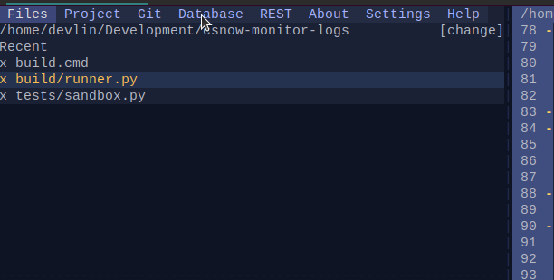
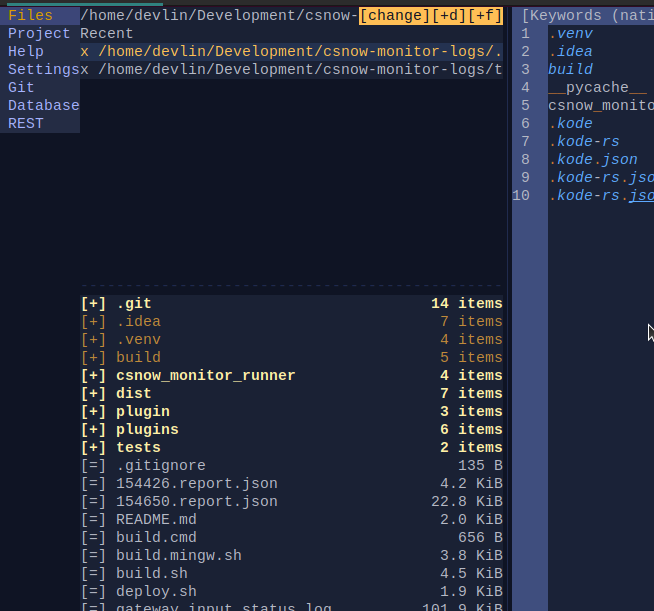
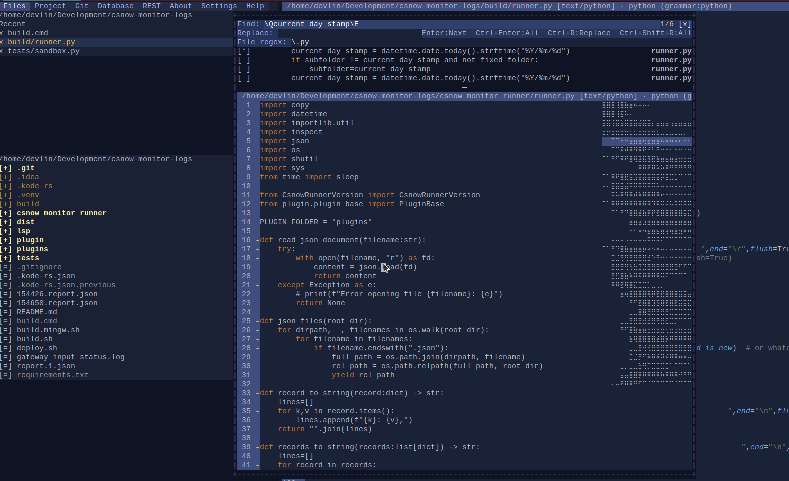
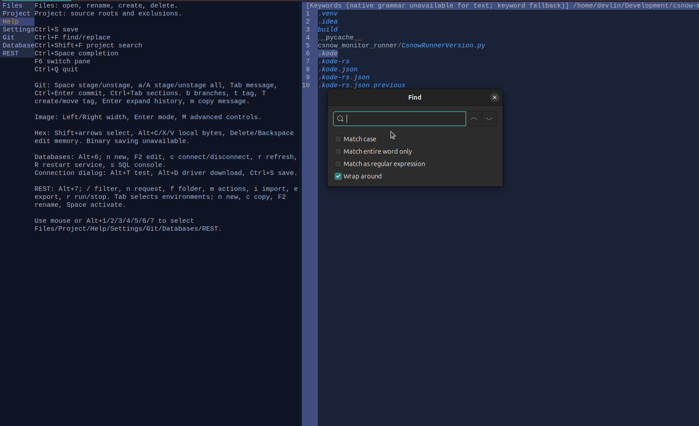
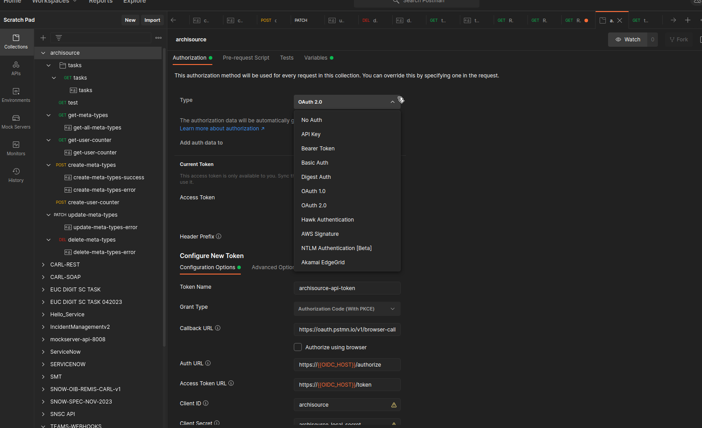
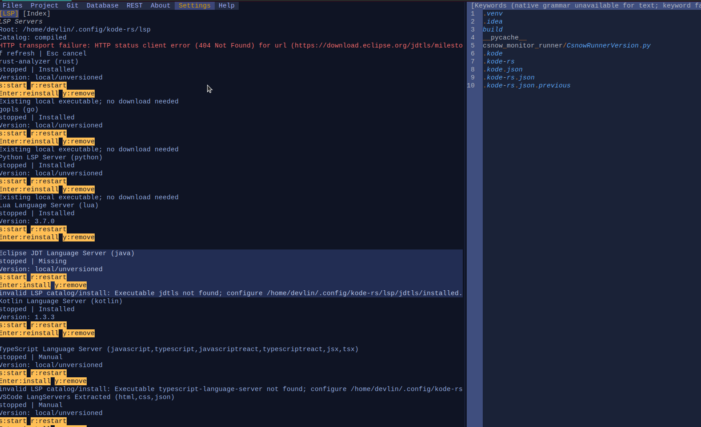
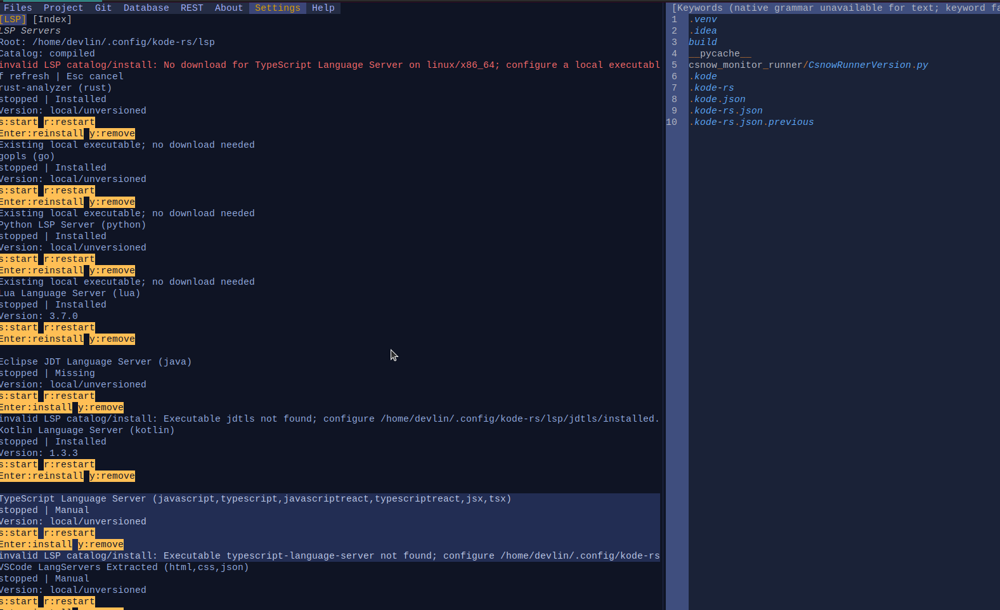
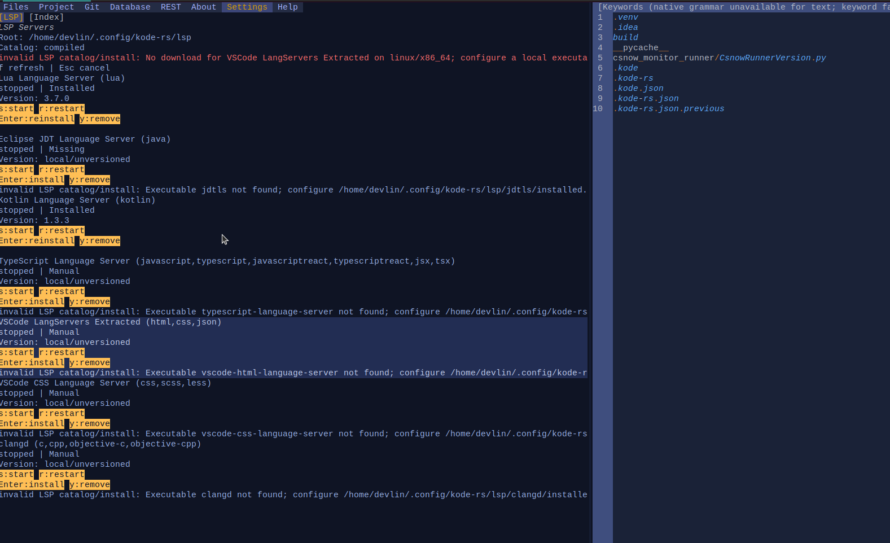
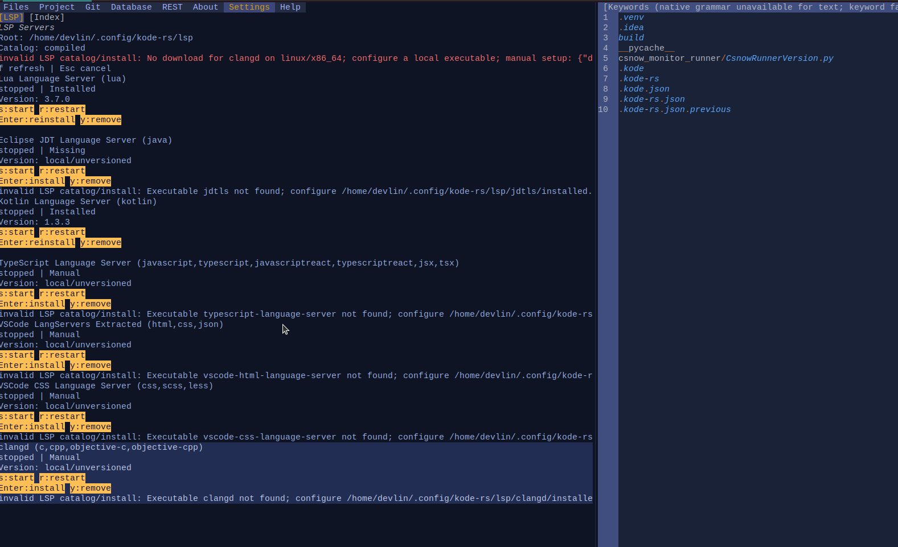
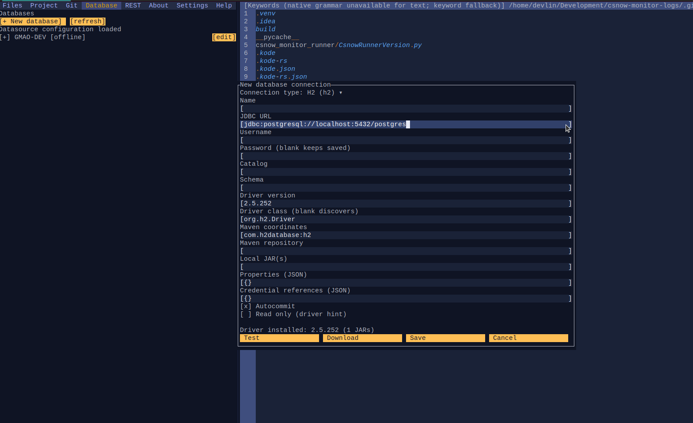

M001 - [todo] - Panel Switchers tab 

left panel tabs switchers should be displayed horizontally and in the indicated order

instead of 

B001 - [todo] - switch to terminal and back ctrl-t 

doesnt work

B002 - [todo] - Editor search and project wide search

search should respond to Ctrl-F
project wide search to Alt-F 

(now ctrl-shift-f is intercepted by the terminal host app)

M002 - [todo] - REST : we should support these authentication protocols and workflows

OAuth has no User interface attached, it should also support opening and rendering the browser page that the user
is redirected to. 
we should actually print an url and let the user copy it so that they can complete the auth workflow in a GUI browser

B003 - [todo] - Database: error messages are not readable

they are printed on a single line and when the line is too long we cannot read maybe the most important parts

M003 - [todo] - Database: jdbc adapter and drivers

it touches the build and packaging aspect, 
The adapter requires :
 - a local jvm
 - jdbc drivers
i think that on the ci build process we can generate a jvm jlink artefact. when kode-rs cannot find java it can offer to download it from the repo releases latest.
 - it will download that artefact
we shouldn't bundle it with uor app because that will probably renderer it much to big

as for the drivers i was thinking about making them also available in the CI build artefacts but on second thought i think the way we manage them right now is better, more flexible.

B004 - [todo] - Editor : multiple cursors

- we should be able to place multiple cursors by Alt-(left)Click, if the user Alt-clicks a cursor that's already in place the cursor should be removed
- we should be able to do multiple selections by Alt-mousedown -> drag -> release
- alt-enter in the file search box should place multiple cursors and multiple selections on all the occurrences found 
- ctrl-shift-arrowUp and ctrl-shift-arrowDown will add another cursor to the position that is reached

M004 - [todo] EDITOR : Hex Editor

- we should support switching between the following layouts : 8, 16(default,current) and 32 columns
- we should support search/find (Ctrl-F) in both plain text or binary

M005 - [todo] Editor : double click 

double click will select the entire word under the cursor,
alt-double-click will add the selected word to selections and a cursor at the end of this new selection

M006 - [todo] - File Picker

the input fields where the user is supposed to enter a path will also be accompanied by a button that allows the user to pick a file from a file tree dialog

B005 - [todo] - File Panel

the list of currently opened files should show their path from the project root instead of the full path.
the full path can be shown optionally

B006 - [todo] - language servers missing

B007 - [todo] - switching left panel tabs

switching with alt-1,2,3,4,5,6,7,8 does not happen in the expected (current, visual) order
alt-5,6,7,8 are not mapped

M007 - [todo] - Database: database jdbc field

the database jdbc field should have a dropdown that suggests the frequently used jdbc url formats for each database according to the selected connection type

M008 - [todo] - Database: packages

where applicable we should support database packages listing and ddl

B008 - [todo] - REST : oauth

redirection url shouldn't point towards postman

my suggestion is to have an internal, efemeral webserver that will intercept the redirect, in which case the redirect
uri should always be something like https://localhost:free-port/callback kode-rs will intercept the token in this manner