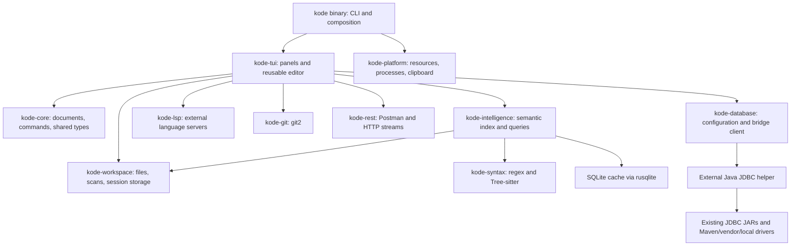

# Kode to Rust: complete migration plan

## Scope and baseline

Source: `/home/devlin/Development/kode`, commit
`7d3e5953ec2de75f2b5e9c44fb3e65549d39ec68`. Destination:
`/home/devlin/Development/kode-rs`. The path in the initial request was resolved to
these existing directories. The destination was empty when planning began.
The source working tree was clean. Research date: 2026-10-14.

The audited implementation has **127 production Kotlin files, 34,386 lines**.
The plan covers all production files, the existing regression suites, resource
formats, terminal behavior, launchers, and distribution. Every production file is
assigned to tasks in [SOURCE-MAP.tsv](SOURCE-MAP.tsv).

| Source area | Files | Lines | Destination responsibility |
|---|---:|---:|---|
| `react` | 14 | 2,109 | Terminal backend, widgets, layout, focus, styles |
| `editor/app` | 5 | 3,575 | CLI, workspace coordination, sessions, serve mode |
| `editor/lib` | 18 | 2,738 | Text/byte buffers, files, Git, image rendering, clipboard |
| `editor/ui` | 21 | 8,244 | Editor, panels, dialogs, diff, viewers |
| `editor/mime` | 4 | 642 | Content detection and viewer routing |
| `editor/grammars` | 4 | 511 | Configurable lexical highlighting |
| `editor/lang` | 6 | 927 | Parser bindings and identifier extraction |
| `editor/codeintel` | 22 | 6,698 | Semantic model, resolution, index, completions |
| `editor/lsp` | 3 | 914 | Optional language servers and installation |
| `editor/database` | 18 | 3,778 | JDBC explorer and SQL consoles |
| `editor/db` | 1 | 204 | Existing internal H2 index lifecycle |
| `editor/rest` | 11 | 4,046 | Postman/OpenAPI workspace and HTTP/SSE/WebSocket client |

“Git module” means the JGit-backed IDE integration, including staging, commits,
branches, tags, history, diff views, and restoring a diff chunk. It does not imply
that `.gitmodules` management is already implemented. The SQL/JDBC module and the
Postman-like REST/OpenAPI module are separate features and both are in scope.

The user finalized the current UAT batch on 2026-10-16 and added it to this goal.
[UAT tracking](UAT.md) maps all sixteen requests to implementation owners and
evidence. R09/R10 own M002 authentication protocols and OAuth acquisition; U01–U12
cover finalized search shortcuts, readable JDBC errors, a separate downloadable
jlink runtime, multiple cursors/selections, hex layouts/find, word double-click,
path pickers, relative open-file labels, LSP installation, sidebar shortcuts, JDBC URL presets and database packages. R10 also owns B008: an ephemeral HTTPS localhost callback replacing Postman defaults. M001/B001 retain Z02/Z01 evidence.
These are extensions/corrections to the frozen baseline, not deferred proposals.

The user also requested the [full Z03 artifact matrix](Z03-ARTIFACT-MATRIX.md):
portable Linux/macOS/Windows for both x86_64 and arm64, AppImages by CPU, Snap,
Windows MSI/MSIX and macOS DMG. Z03 is reopened and resumes after the Uxx series.
The matrix records the authorized Windows SSH test host/project directory and
the actual-build/install/runtime evidence required for every platform/CPU.

Final search mapping is **Ctrl+F file find; Alt+F project search**, superseding
earlier preferences. OAuth prints a copyable login URL for a GUI browser.
The optional runtime is a separate release artifact, offered when local Java is
unavailable; current flexible JDBC driver management stays in place. E13/Z03/Z04
include the relevant new prerequisites and cannot finish before their UAT work.

Use executable source and focused tests to determine current behavior. README and
`SPEC.*` files provide context, but some describe proposals. For example, rename,
SCIP/compiler/ML enrichment, and parts of LSP diagnostics are interfaces or future
work, rather than complete features. F01 records these distinctions. No implemented
feature may be dropped by calling it a proposal.

## Decisions

1. **Rust TUI:** Ratatui and Crossterm replace ANSI drawing, terminal setup, and
   input decoding. Kode owns its editor layout, state, hit testing, and focus.
2. **Editor parity is a release gate:** retain the full code editor and every
   embedded editor. [EDITOR-UX.md](EDITOR-UX.md) is an explicit interaction contract.
   An editor demo or a generic text-area widget does not satisfy that gate.
3. **External JDBC JVM:** retain JDBC URL/driver compatibility through a Java 21
   helper launched on demand. Rust owns the database UI, configuration, and client
   state; the helper owns JDBC and Maven artifact resolution. This incorporates
   the user's explicit preference for an external JVM. Neither `jni` nor `j4rs`
   is an application dependency under this design.
4. **Rust Git:** use `git2` for the existing JGit operations. Preserve the user
   interaction and repository behavior, including safe chunk restoration.
5. **Rust REST:** use `reqwest`, `tokio-tungstenite`, and `eventsource-stream`.
   Postman documents remain an extensible JSON tree; importing OpenAPI is a
   transformation into that tree, not the REST client's runtime model.
6. **Native internal index:** replace the internal H2 code index with SQLite via
   `rusqlite`. It is a rebuildable cache. This is independent of user H2/JDBC
   connections, which continue to use JDBC. Editing/indexing must work without Java.
7. **Preserve data:** read legacy `.kode.json` version 6 and legacy user datasource
   files; write versioned Rust state separately until an explicit export/migration
   operation is implemented. Never reinterpret UTF-16 coordinates as byte offsets.
8. **Library adoption has evidence:** crate capabilities were checked in primary
   documentation. Build/API compatibility has not yet been proven. The owning task
   must pin versions and perform its specified integration experiment before use.

## Architecture



Proposed workspace:

```text
Cargo.toml                         # workspace dependencies and resolver
Cargo.lock                        # committed application dependency resolution
rust-toolchain.toml                # latest stable per user; exact tested version in reports
crates/kode/                       # binary; CLI and application composition
crates/kode-core/                  # coordinates, buffers, commands, DTOs
crates/kode-platform/              # clipboard, resources, process support
crates/kode-workspace/             # files, scanner, session and project search
crates/kode-syntax/                # keyword grammars and parser registry
crates/kode-intelligence/          # semantic facts, resolver, index, completion
crates/kode-lsp/                   # LSP client and server catalog
crates/kode-git/                   # Git service and diff data
crates/kode-rest/                  # collection model, resolver, importer, execution
crates/kode-database/              # datasource models, protocol, JDBC client
crates/kode-tui/                   # app reducer, editor, widgets, feature panels
jdbc-bridge/                      # Java 21 Maven module; no Kotlin dependency
resources/                        # licensed catalogs, keywords, styles
fixtures/                         # synthetic, checked-in parity cases
protocol/jdbc-v1/                 # schema and language-neutral wire fixtures
docs/migration/                   # this plan and task ledger
```

Domain crates do not depend on `kode-tui`. `kode-core` does not depend on feature
crates. Feature code reports owned data and events; it does not mutate TUI objects.
`kode-workspace` stores feature session blocks as JSON values, allowing REST and
database models to evolve without dependency cycles. The application composition
layer converts those blocks through each feature's import/export functions.

The main thread owns terminal output, focus, document edits, and application state.
Tokio runs process/network operations. Bounded workers run blocking Git, filesystem,
SQLite, parsing, and image tasks. Immutable snapshots cross worker boundaries.
Every asynchronous result carries workspace generation and request identity;
document work also carries document revision. Old results cannot overwrite a newer
edit, a newly opened file, or a switched workspace.

## Delivery order

Each milestone is a usable integration checkpoint, not permission to stop the
migration. All milestones are required for full completion.

| Milestone | User-visible outcome | Tasks |
|---|---|---|
| M0 | Baseline fixtures, interfaces, dependency decisions | F01–F03 |
| M1 | TUI opens a project and offers the complete core editing experience | F04–F05, E01–E08, E12, W01–W03, W05, V01 |
| M2 | Native code intelligence, editor popups, project search, all viewers | L01–L12, E09–E11, W04–W05, V02–V03, P01–P03 |
| M3 | Full Git workflow and diff UX | G01–G03 |
| M4 | Existing JDBC advantage retained through external Java | D01–D09 |
| M5 | Complete REST/Postman/OpenAPI UX | R01–R08 |
| M6 | Browser terminal mode, packaging, editor and full parity qualification | E13, Z01–Z04 |

M1 uses fake intelligence providers for the editor shell where necessary; E12's
host API does not depend on real semantic extraction. M2 must connect real providers
and close all corresponding editor acceptance rows. The task index supplies the
precise prerequisites; milestone grouping does not override them.

## Work sizing and handoff

Tasks are intentionally smaller than “port the editor,” “replace JGit,” or “port
REST.” Each card specifies source files to read, destination ownership, contracts,
ordered work, and behavioral checks. Follow [HANDOFF.md](HANDOFF.md). Complete the
listed substeps in order and record evidence before claiming a task complete.

For the largest semantic and protocol tasks, implement each numbered substep as a
separate reviewable change. If a card still cannot fit one focused working session,
split it in the ledger while preserving its contract and acceptance IDs. Do not
replace its implementation with a placeholder in order to mark it complete.

## Highest-risk work

| Risk | Resolution owner and evidence |
|---|---|
| Editor interactions differ after moving to a widget library | E01–E13; replay all EDITOR-UX cases with state and cell assertions |
| Kotlin UTF-16 coordinates corrupt Rust selections/tokens | E01 and W03; explicit byte/scalar/UTF-16/cell conversion fixtures |
| Background completion overwrites current document/workspace | F03, E04, L09, P02, R05, D02; stale-response tests |
| JDBC cancellation queues behind the running query | D02/D05; independent control executor and long-running query cancellation |
| JVM/driver restart destroys a transaction | D02/D04; disconnected/unknown-outcome states, no automatic SQL replay |
| Maven drivers need transitive runtime dependencies | D03; Apache Maven Resolver and isolated classloaders |
| Tree-sitter grammar APIs/AST node names differ | L02–L04; pinned ABI-compatible bindings and actual extraction fixtures |
| Postman fields disappear on save/export | R01; arbitrary-field round-trip fixtures, including scripts and extensions |
| OpenAPI schema parsing is mistaken for Postman conversion | R03; explicit 2.0/3.x import fixture matrix |
| The source's broad image catalog exceeds one decoder crate | V03; format matrix for raster, SVG, PSD, KRA, DDS |
| Browser shortcuts and terminal variants lose input | F04, E13, Z01/Z04; PTY plus manual terminal matrix |

No duration estimate is used as a completion criterion. Full migration is complete
only when [COMPATIBILITY.md](COMPATIBILITY.md) and every implemented-feature row in
the editor contract have evidence and no unexplained regression remains.
